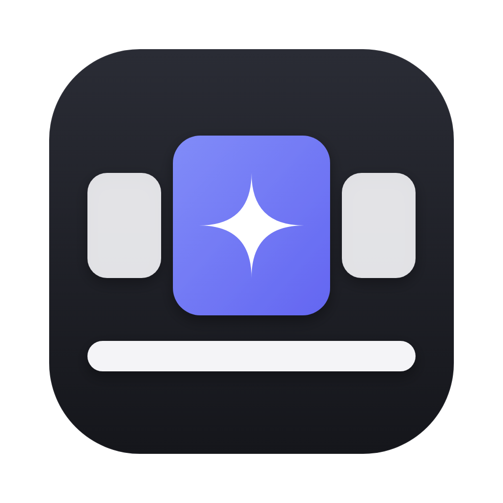

<p align="center"></p>

<h1 align="center">Mission Desk</h1>

<p align="center">All your web apps side by side, organised in spaces, with one Home for your day and an assistant that knows each space.</p>

Mission Desk is a free, open-source desktop app by [Rumi Labs, Lda.](https://rumilabs.pt) It keeps your Gmail, Outlook, Slack, WhatsApp and other web apps in one window, each account signed in on its own. Spaces group them by company, project or part of your life.

## Download

Get it from the website, **[missiondesk.rumilabs.pt](https://missiondesk.rumilabs.pt)**, or from the [Releases page](../../releases/latest).

| System | File | Notes |
|---|---|---|
| macOS, Apple silicon | `Mission-Desk-<version>-mac-arm64.dmg` | Signed and notarized. Open the .dmg and drag Mission Desk to Applications. |
| macOS, Intel | `Mission-Desk-<version>-mac-x64.dmg` | As above. |
| Windows 10 and 11 | `Mission-Desk-<version>-win-x64.exe` | Beta. The installer isn't signed yet, so Windows may say it "protected your PC": choose **More info → Run anyway**. |
| Linux | `Mission-Desk-linux-x86_64.AppImage` or `Mission-Desk-<version>-linux-amd64.deb` | Beta. Make the AppImage executable (`chmod +x`) and run it, or install the .deb with `sudo apt install ./Mission-Desk-…deb`. |

Mission Desk updates itself: it looks for new versions on GitHub, downloads them in the background and installs them when you restart it (a `.deb` on Linux tells you instead). What's new in each version: [CHANGELOG.md](CHANGELOG.md). Your version is in **Settings → About**.

## What it does

- **Apps side by side.** Google (Gmail, Calendar, Drive, Meet), Microsoft 365 (Outlook, Teams), Slack, WhatsApp, Telegram, LinkedIn, Discord, Zoom, Notion, Proton Mail, iCloud Mail, Fastmail and any website. As many accounts as you like, each with its own login, cookies and storage.
- **Spaces.** Group apps by company or project, as folders or sections in the sidebar. A space can share one Google sign-in between its apps.
- **Home.** What's next on your calendar with one click to join the call, your to-dos, and Messages: the latest chat or email of each conversation from every app.
- **One calendar.** Every Google account's calendar in a single Day, Week or Month view, where you can create, move and answer events.
- **An assistant per space.** A floating chat that reads only the apps you share with it, on your own Claude Code, OpenAI Codex or OpenRouter account. It asks before it acts.
- **Notifications and badges** per app and per space, with mute. Apps you don't use go to sleep to save memory.
- **Meetings, transcribed on your Mac.** Meet, Teams and Zoom calls inside Mission Desk, transcribed locally (Apple's engine, Whisper or Parakeet; the audio never leaves the Mac), then summarised by the space's assistant into to-dos, "waiting on" items and a follow-up draft.
- **In your language.** English, Português (Portugal and Brasil), Español, Français, Deutsch, Italiano and Nederlands. It follows your Mac's language, or pick one in Settings → General.

The [user guide](docs/guide.md) explains each feature in detail.

## Privacy

Mission Desk has no server and no telemetry. It talks only to the services you add, to the assistant you choose (only when you use it, and only with the apps you share with it), and to GitHub to look for new versions (you can turn that off in **Settings → About**).

Your apps' logins and your settings stay on your computer, in this folder:

- macOS: `~/Library/Application Support/Mission Desk/`
- Windows: `%APPDATA%\Mission Desk\`
- Linux: `~/.config/Mission Desk/`

Calendar events and Home's messages are kept only in memory while Mission Desk runs; they are never written to disk. An OpenRouter key is encrypted by the system's keychain.

## Build from source

You need [Node.js](https://nodejs.org) 22 or newer and Git.

```bash
git clone <this repository>
cd mission-desk
npm install
npm run dev
```

`npm run dev` starts the app with hot reload. Other commands:

| Command | What it does |
|---|---|
| `npm test` | Unit tests (Vitest) |
| `npm run typecheck` | TypeScript checks |
| `npm run dist` | An unsigned macOS app in `dist/mac-arm64/` (or `mac/` on Intel), for trying a build locally |
| `npm run dist:mac`, `dist:win`, `dist:linux` | Installers for each system, in `dist/` |

Development-only environment variables (ignored in built apps):

| Variable | Effect |
|---|---|
| `MISSIONDESK_USER_DATA` | Use another data folder instead of your real one |
| `MISSIONDESK_DEBUG_PORT` | Open a Chrome DevTools remote-debugging port |
| `MISSIONDESK_IDLE_MS` | Override the 10-minute sleep time for unused pages |

How a release is built, signed and published: [docs/RELEASING.md](docs/RELEASING.md).

### How the code is organised

- `src/main/` — the Electron main process: windows and app pages, accounts and spaces, notifications, calendar, the assistant engines and Mission Desk's tools for them.
- `src/renderer/` — the interface (React): sidebar, Home, calendar, settings, setup, assistant chat.
- `src/preload/` — the bridges between pages and the main process.
- `src/shared/` — rules and types used by both sides; most of the tested logic lives here.
- `tests/` — unit tests.

## Contributing

Contributions are welcome. See [CONTRIBUTING.md](CONTRIBUTING.md); every commit needs a `Signed-off-by` line ([Developer Certificate of Origin](DCO)). To report a security problem, see [SECURITY.md](SECURITY.md).

## License

Copyright © 2026 **Rumi Labs, Lda.** Mission Desk is free and open source, released under the [GNU General Public License v3.0 or later (GPL-3.0-or-later)](LICENSE).

- **You can:** use it free of charge, as a person or a company, for anything, work included; read, change and improve the code; share it, changed or not.
- **You must:** when you share Mission Desk or a version you changed, share its source code too, under the same license. Nobody can turn it into a closed product.
- **No warranty:** Mission Desk is provided as is, without any warranty (see sections 15 and 16 of the license).

## Disclaimer

Mission Desk is an independent project. It is not affiliated with or endorsed by Google, Microsoft, Slack, Meta/WhatsApp, Telegram, LinkedIn, Discord, Zoom, Notion, Proton, Apple, Fastmail, Anthropic, OpenAI or OpenRouter. Product names are used only to identify the services.
